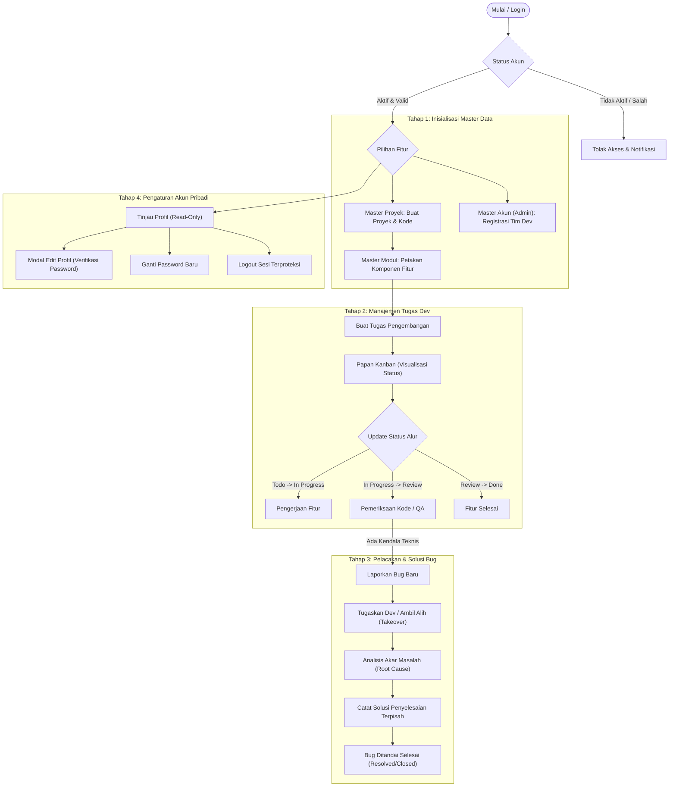

# Alur Kerja dan Panduan Fitur Aplikasi Monitoring & Manajemen IT Developer

Dokumen ini menjelaskan rancangan alur kerja (*workflow*), hierarki fitur, hak akses, serta panduan operasional aplikasi yang telah diimplementasikan pada antarmuka pengguna (*User Interface*).

---

## 1. Ikhtisar Aplikasi

**Aplikasi Monitoring & Manajemen IT Developer** dirancang sebagai sistem terpadu untuk memonitor siklus pengembangan perangkat lunak, memfasilitasi kolaborasi tugas harian tim pengembang, melacak temuan bug dari tim QA, serta mengelola data master proyek dan modul secara terstruktur.

Antarmuka dibangun dengan prinsip:
- **Tegas dan Bersih**: Mengedepankan hierarki informasi visual yang jelas tanpa elemen dekoratif berlebih.
- **Tanpa Tab Bersarang**: Meminimalkan kebingungan navigasi dengan memanfaatkan modal interaktif tunggal untuk aksi CRUD.
- **Ramah Desktop & Tablet**: Tata letak fleksibel dengan dukungan *collapsible sidebar* pada layar tablet/mobile dan tabel responsif.

---

## 2. Peran Pengguna (*User Roles*)

Aplikasi membagi hak akses ke dalam 2 tingkatan peran:

1. **Administrator (Atasan / Project Manager)**
   - Mengelola akun seluruh pengguna (tambah akun baru, edit peran, ubah status aktif, reset kata sandi, hapus akun).
   - Mengelola master data proyek dan master modul fitur.
   - Mengelola dan memonitor seluruh tugas operasional serta temuan bug tim.
   - Mengambil alih penanganan tugas atau bug (*takeover*) kapan saja.
   - Mengelola profil pribadi pada halaman Akun Saya.

2. **Developer (Anggota Tim Pengembang)**
   - Mengelola master proyek dan modul untuk kebutuhan teknis.
   - Mengelola tugas pada Papan Kanban dan Daftar Tugas.
   - Melaporkan bug, mencatat analisis akar masalah (*root cause*), dan memperbarui solusi perbaikan teknis.
   - Mengambil alih penanganan tugas atau bug dari rekan tim yang membutuhkan delegasi.
   - Memperbarui profil dan kata sandi akun pribadi.

---

## 3. Struktur Navigasi Antarmuka

Menu navigasi sidebar dikelompokkan secara logis ke dalam 3 kategori:

```
[Sidebar Navigasi]
|-- 1. FITUR OPERASIONAL
|   |-- Papan Kanban      (/kanban)
|   |-- Daftar Tugas      (/tasks)
|   `-- Pelacak Bug       (/bugs)
|
|-- 2. FITUR MASTER DATA
|   |-- Master Proyek     (/projects)
|   |-- Master Modul      (/modules)
|   `-- Master Akun       (/admin/accounts) -> Khusus Administrator
|
`-- 3. PENGATURAN
    `-- Akun Saya         (/account)
```

> **Catatan Keamanan Akses**: Tombol **Logout** ditempatkan secara khusus di dalam kartu ringkasan profil pada halaman **Akun Saya**, bukan di sidebar global, guna mencegah sesi keluar secara tidak disengaja.

---

## 4. Diagram Alur Kerja Utama (*Workflow*)



---

## 5. Rincian Alur Operasional Per Fitur

### 5.1. Master Proyek (`/projects`)
- **Tujuan**: Menampung informasi payung proyek sistem yang sedang dikerjakan.
- **Alur Kerja**:
  1. Klik tombol **Tambah Proyek** pada header halaman.
  2. Isi nama proyek, kode singkat unik (otomatis dikonversi ke huruf kapital, misal: `HRIS`), warna identitas, status siklus (*Aktif*, *Pemeliharaan*, *Diarsipkan*), dan URL repositori Git.
  3. Tabel menampilkan statistik cakupan jumlah modul, tugas, dan temuan bug yang terhubung secara otomatis.
  4. Pengguna dapat mengubah rincian proyek melalui tombol **Edit** atau menghapus proyek melalui tombol **Hapus** (didukung konfirmasi aman).

### 5.2. Master Modul (`/modules`)
- **Tujuan**: Memecah proyek menjadi komponen fitur spesifik (misal: *Autentikasi*, *Penggajian*, *Laporan*).
- **Alur Kerja**:
  1. Klik tombol **Tambah Modul**.
  2. Pilih proyek induk terkait, masukkan nama modul, dan berikan deskripsi ruang lingkup pekerjaan teknis.
  3. Modul yang terdaftar menjadi referensi penugasan saat membuat tugas dev maupun mencatat bug.
  4. Tabel menyediakan filter instan berdasarkan proyek induk untuk mempermudah inventarisasi modul per sistem.

### 5.3. Master Akun (`/admin/accounts` - Khusus Admin)
- **Tujuan**: Pengelolaan data identitas pengguna sistem secara terpusat oleh atasan.
- **Alur Kerja**:
  1. Admin membuka halaman Master Akun untuk melihat seluruh anggota tim.
  2. Klik **Tambah Pengguna Baru** untuk mendaftarkan akun Developer atau Admin baru.
  3. Admin dapat memperbarui identitas pengguna, mengganti peran (*Admin* / *Developer*), mengaktifkan/menonaktifkan akun melalui tombol *toggle*, serta mengatur ulang kata sandi pengguna secara instan.
  4. Akun yang dinonaktifkan akan langsung ditolak saat mencoba masuk ke sistem.

### 5.4. Papan Kanban (`/kanban`)
- **Tujuan**: Visualisasi alur pengerjaan tugas secara langsung melalui 4 tahapan status:
  - **To Do**: Tugas baru yang siap dikerjakan.
  - **In Progress**: Tugas yang sedang aktif dikerjakan oleh developer.
  - **Review**: Tugas yang menunggu evaluasi kode atau pengetesan QA.
  - **Done**: Tugas yang telah selesai dan tuntas diuji.
- **Fitur Andalan**:
  - **Dropdown Filter Cepat**: Filter kartu berdasarkan proyek atau penanggung jawab tanpa memuat ulang seluruh halaman.
  - **Pemberitahuan Kendala (*Blocker Notes*)**: Kartu tugas menampilkan label peringatan mencolok jika terdapat kendala pengerjaan.
  - **Modal Edit Tugas Instan**: Pembaruan deadline, status, dan blocker melalui jendela modal yang bersih.
  - **Ambil Alih (*Takeover*)**: Anggota tim dapat mengambil alih tugas rekan lain dengan konfirmasi log riwayat otomatis.

### 5.5. Daftar Tugas (`/tasks`)
- **Tujuan**: Tampilan komprehensif seluruh tugas pengembangan dalam bentuk tabel data untuk monitoring kuantitatif.
- **Fitur Andalan**:
  - Kolom pencarian judul, filter proyek, tipe tugas (*Feature*, *Bugfix*, *Refactor*, *Documentation*), dan filter status.
  - Ringkasan statistik tugas (*Total Tugas*, *Dalam Pengerjaan*, *Perlu Review*, *Selesai*).
  - Aksi penambahan tugas baru, pengeditan rincian teknis, dan penghapusan tugas.

### 5.6. Pelacak Bug (`/bugs`)
- **Tujuan**: Dokumentasi temuan masalah sistem, pemetaan tingkat bahaya, dan pencatatan riwayat penyelesaian bug.
- **Alur Kerja Khusus Solusi & Riwayat**:
  1. **Pemisahan Aksi yang Tegas**: Pada tabel bug, tombol aksi dipisahkan menjadi:
     - **Detail**: Membuka modal riwayat pelaporan, pelapor, modul terkait, dan deskripsi temuan (dapat diedit secara mandiri).
     - **Solusi**: Membuka modal khusus untuk mencatat dan meninjau analisis akar masalah (*root cause*) serta langkah perbaikan teknis (*solution notes*).
     - **Ambil Alih (Takeover)**: Mengalihkan penugasan bug ke developer yang sedang aktif menangani perbaikan.
     - **Hapus**: Menghapus catatan bug yang tidak valid atau duplikat.
  2. **Indikator Solusi Visual**: Baris data bug secara otomatis memberikan badge status solusi (misal: *Sudah ada Solusi* atau *Menunggu Analisis*) agar tim mengetahui isu yang belum tertangani.

### 5.7. Akun Saya (`/account`)
- **Tujuan**: Manajemen akun personal dan autentikasi pengguna yang sedang aktif.
- **Fitur Andalan**:
  - **Tampilan Aman Read-Only**: Informasi profil disajikan dalam tampilan bersih untuk menghindari pengeditan yang tidak disengaja.
  - **Modal Edit Profil Terverifikasi**: Tombol *Edit Profil* membuka modal khusus yang mewajibkan input kata sandi saat ini sebelum perubahan profil (nama, email, avatar) dapat disimpan.
  - **Form Pembaruan Password Terpisah**: Formulir perubahan kata sandi dilengkapi validasi konfirmasi kata sandi baru.
  - **Pusat Logout Aman**: Tombol keluar sesi (*Logout*) terintegrasi di kartu profil sisi kiri dengan konfirmasi token CSRF.

---

## 6. Ringkasan Status Endpoint & File Antarmuka

| Fitur | Rute Web | Controller Utama | File Blade View |
| :--- | :--- | :--- | :--- |
| **Papan Kanban** | `/kanban` | `TaskController@kanban` | `resources/views/kanban/index.blade.php` |
| **Daftar Tugas** | `/tasks` | `TaskController` | `resources/views/tasks/index.blade.php` |
| **Pelacak Bug** | `/bugs` | `BugController` | `resources/views/bugs/index.blade.php` |
| **Master Proyek** | `/projects` | `ProjectController` | `resources/views/projects/index.blade.php` |
| **Master Modul** | `/modules` | `ModuleController` | `resources/views/modules/index.blade.php` |
| **Master Akun** | `/admin/accounts` | `Admin\AccountController` | `resources/views/admin/accounts/index.blade.php` |
| **Akun Saya** | `/account` | `AccountController` | `resources/views/account/edit.blade.php` |
| **Autentikasi** | `/login`, `/logout` | `AuthController` | `resources/views/auth/login.blade.php` |
